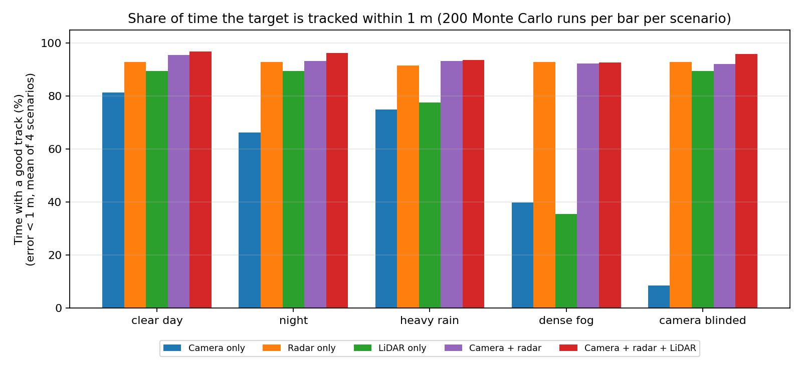
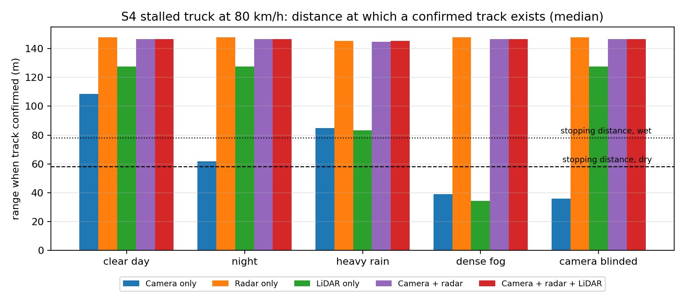

# Feasibility Study on Sensor Fusion for Autonomous Systems

**Week 2 task, Automotive AI Innovation Internship (YuvaIntern)**

A feasibility study of AI-based fusion of **cameras, radar, LiDAR and ultrasonic sensors** for automated driving on Indian roads, building on the Saarthi Copilot platform from the [Week 1 roadmap](https://github.com/himshxrmx/automotive-ai-strategic-roadmap). Besides the literature review, it includes a **Monte Carlo tracking experiment (20,000 simulated runs)** that measures how each sensor combination behaves at night, in heavy rain, in dense fog and when the camera is blinded.

📄 **Full report:** [Week2_Sensor_Fusion_Feasibility_Study.docx](Week2_Sensor_Fusion_Feasibility_Study.docx)

## Key results

Share of time the target is tracked within 1 m (mean of four scenarios: car cut-in, pedestrian crossing, weaving motorbike, stalled truck at 80 km/h):

| Configuration | Clear day | Night | Heavy rain | Dense fog | Camera blinded |
|---|---|---|---|---|---|
| Camera only | 81.4% | 66.2% | 74.9% | 39.9% | 8.5% |
| Radar only | 93.0% | 93.0% | 91.5% | 92.9% | 93.0% |
| LiDAR only | 89.5% | 89.5% | 77.6% | 35.6% | 89.5% |
| Camera + radar | 95.5% | 93.3% | 93.2% | 92.3% | 92.2% |
| **Camera + radar + LiDAR** | **96.7%** | **96.3%** | **93.6%** | **92.6%** | **96.0%** |

- **Stalled truck at 80 km/h:** stopping distance is 58 m (dry) / 78 m (wet). A camera alone confirms the truck at only 39 m in fog; every configuration with radar confirms it at about 147 m.
- **Worked example at 30 m:** camera ±1.1 m range / ±0.05 m lateral, radar ±0.15 m / ±0.52 m, fused **±0.15 m / ±0.05 m**.
- **Calibration:** 1° radar misalignment = 0.87 m sideways at 50 m. Fusion absorbs up to 1° with online correction; at 3° camera and radar fight and accuracy drops, so the system must flag recalibration.
- **Timing:** a 100 ms camera timestamp error doubles camera-only error on the truck, but camera + radar fusion barely changes.




## Feasibility scorecard

Nine weighted criteria, each scored 1–5 against fixed anchors (full table in Section 9.5 of the report):

| Target | Weighted score | Decision |
|---|---|---|
| Level 2+ assistance and geofenced low-speed autonomy | 3.85 / 5 | ✅ GO |
| Open-road driverless operation in India | 2.55 / 5 (data and regulation scored 1) | ⛔ NO-GO for now |

Indicative sensor + compute cost per vehicle: Tier A (camera + radar + ultrasonic) ₹1.06 lakh, Tier B (+ forward LiDAR) ₹1.73 lakh, Tier C (full 360° suite) ₹2.83 lakh.

## Proposed architecture

Bird's-eye-view (BEV) mid-level fusion with uncertainty-aware gating, plus an independent radar and ultrasonic safety channel.


## Repository

```
src/fusion_sim.py       Monte Carlo simulation: sensor models, scenarios, EKF tracker, experiments
src/build_report.py     builds the Word report from the results
src/doclib.py           small python-docx helper
content/base_text.json  reusable text sections of the report
results/                fusion_results.csv (100 cells), experiments.json
figures/ images/        charts and diagrams used in the report
```

## Reproduce

```bash
pip install numpy pandas matplotlib python-docx
python src/fusion_sim.py      # about 40 s
python src/build_report.py
```

The sensor models are typical datasheet-level assumptions, and the simulation tests fusion logic rather than a trained neural detector; Section 8.9 of the report lists what it does and does not show.

---
Him Sharma · Automotive AI Innovation Internship (YuvaIntern) · November 2026
