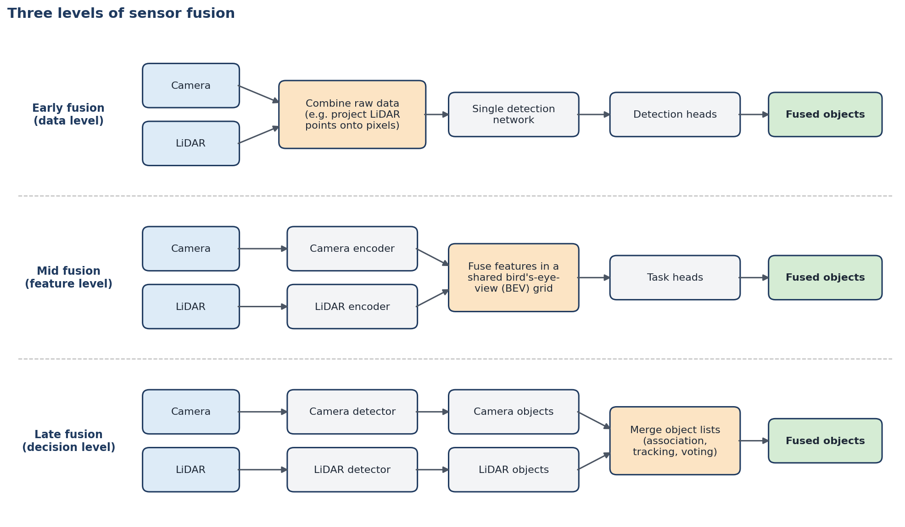
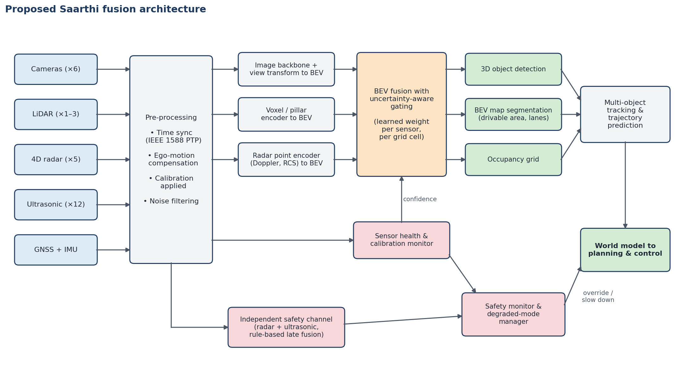
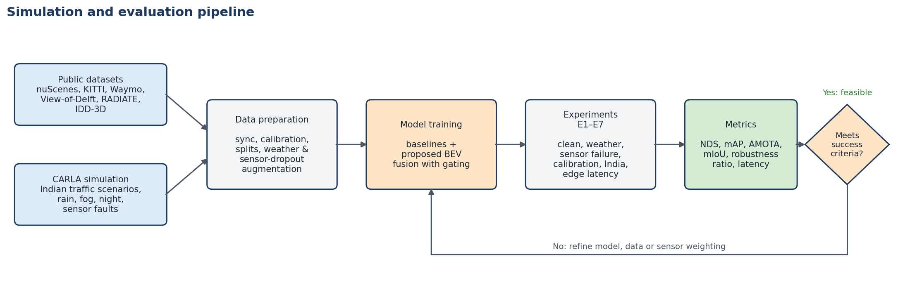
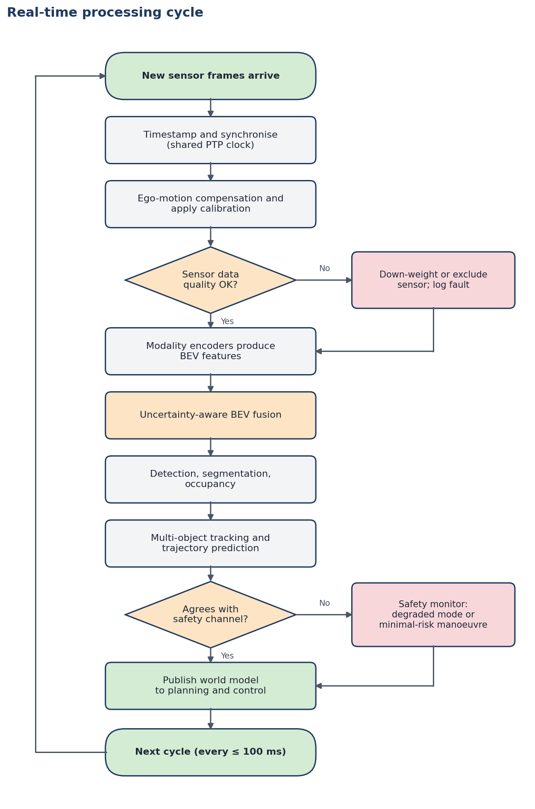
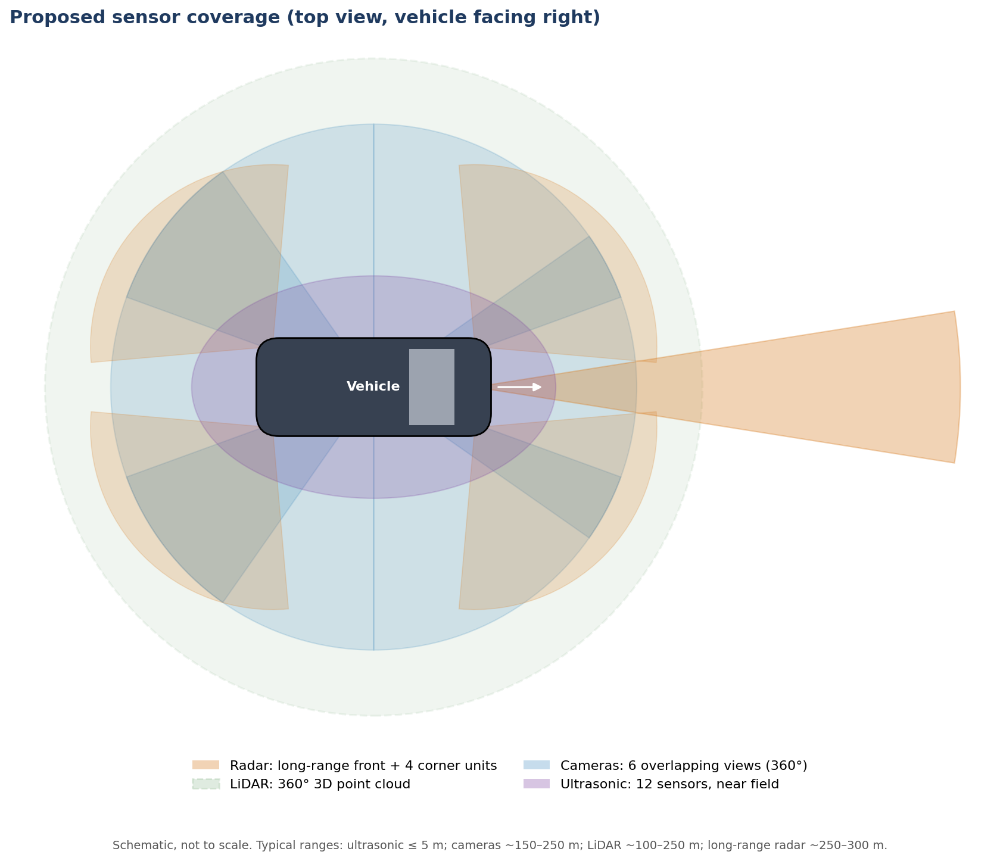

# Feasibility Study on Sensor Fusion for Autonomous Systems

**Week 2 task, Automotive AI Innovation Internship (YuvaIntern)**

A feasibility study of an AI-based sensor fusion system that combines **cameras, LiDAR, radar and ultrasonic sensors** for autonomous driving in Indian mixed traffic. It builds on the Saarthi Copilot platform from the [Week 1 roadmap](https://github.com/himshxrmx/automotive-ai-strategic-roadmap).

📄 **Full report:** [Week2_Sensor_Fusion_Feasibility_Study.docx](Week2_Sensor_Fusion_Feasibility_Study.docx)

## Verdict

| Use case | Feasibility |
|---|---|
| Level 2+ assisted driving | ✅ Feasible now |
| Low-speed autonomy in geofenced areas (campuses, ports, industrial sites) | ✅ Feasible now |
| Full autonomy on open Indian roads | ⏳ Medium to long term (data, cost and regulation) |

## Why fusion?

| Sensor | Best at | Weak at |
|---|---|---|
| Camera | Colour, texture, signs, lanes | Darkness, glare, no direct depth |
| LiDAR | Precise 3D shape and distance | Heavy rain, fog, dust; cost |
| Radar | Speed and range in any weather | Low resolution, ghost targets |
| Ultrasonic | Cheap close-range detection | Only ~5 m range |

## Fusion levels



## Proposed architecture

A **bird's-eye-view (BEV) mid-level fusion** network with **uncertainty-aware gating** (a learned weight for each sensor in each grid cell), plus an **independent radar and ultrasonic safety channel** for redundancy.



The full pipeline is budgeted at **95 ms** per cycle, below the 100 ms target.

## Ten integration challenges

Calibration drift · temporal misalignment · different data formats · adverse weather · conflicting measurements · Indian mixed traffic · compute and power limits · cost · data scarcity · safety validation and security. Each is mapped to an AI mitigation in Section 5 of the report.

## Simulation and evaluation plan



- **Datasets:** nuScenes, KITTI, Waymo Open, View-of-Delft (4D radar), RADIATE (bad weather), IDD-3D (India)
- **Simulator:** CARLA with custom Indian traffic scenarios, co-simulated with SUMO
- **Experiments E1–E7:** baselines, adverse weather, sensor failure, calibration errors, Indian traffic transfer, 4D radar value, edge latency
- **Metrics:** NDS, mAP, AMOTA, mIoU, robustness ratio, false-alarm rate, latency

## Supplementary diagrams

| Processing flowchart | Sensor coverage |
|---|---|
|  |  |

## Repository contents

```
.
├── README.md
├── Week2_Sensor_Fusion_Feasibility_Study.docx   # the full report
└── images/
    ├── fig1_fusion_levels.png
    ├── fig2_architecture.png
    ├── fig3_simulation_pipeline.png
    ├── fig4_processing_flowchart.png
    └── fig5_sensor_coverage.png
```
